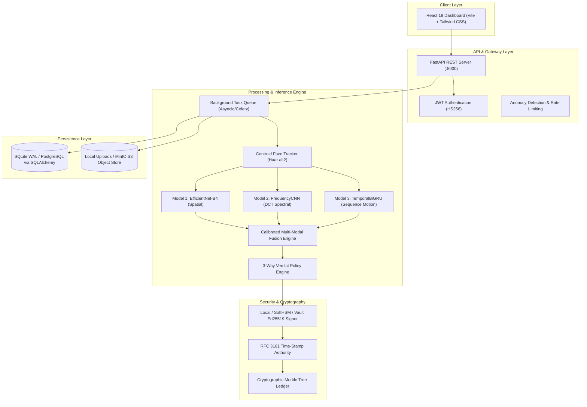
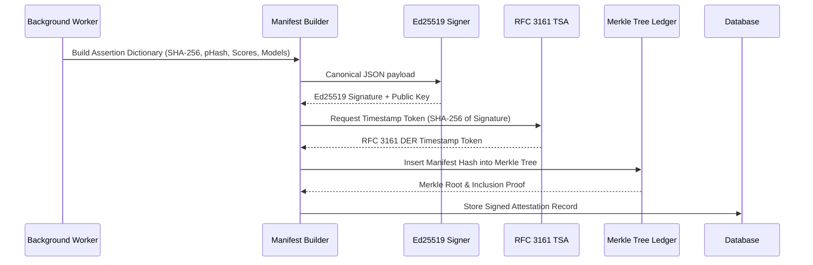

# DeepFake Detection & Cryptographic Attestation Platform
## Comprehensive Technical Master Documentation

---

## 1. Executive Summary & Project Mission

The **DeepFake Detection & Cryptographic Attestation Platform** is an enterprise-grade system designed to solve two interconnected challenges in modern digital media integrity:
1. **Accurate, Multi-Domain Manipulation Detection**: Detecting deepfakes, AI face-swaps, lip-sync syntheses, and generative face reconstructions across spatial, spectral, and temporal domains.
2. **Cryptographic Provenance & Tamper-Proof Attestation**: Producing verifiable, signed digital certificates of authenticity (incorporating **Ed25519 digital signatures**, **RFC 3161 compliant timestamps**, and **Merkle tree ledger inclusion**) modeled after C2PA media authenticity standards.


---

## 2. System Architecture Overview

The system is organized into modular tiers ensuring separation of concerns between media ingestion, deep learning inference, cryptographic signing, persistent storage, and client interaction.



---

## 3. The 3-Model Deep Learning Ensemble

Deepfake manipulation artifacts manifest in three distinct domains. Relying on any single domain yields high false positive or false negative rates (e.g., webcam compression noise mistaken for AI generation, or clean static frames masking temporal flickering). This platform combines three dedicated neural networks:

### 3.1 Model 1: Spatial Domain Detector (`EfficientNet-B4`)
* **File**: `ml/models/efficientnet_b4.py`
* **Weights**: `weights/spatial.pt` (70.9 MB)
* **Purpose**: Inspects high-resolution visual cues within individual facial crops ($380 \times 380\text{ px}$).
* **Target Artifacts**:
  - Blending boundaries around the eyes, nose, and mouth.
  - Warping artifacts produced by autoencoder decoders (e.g., DeepFaceLab, FaceSwap).
  - Unnatural skin textures, missing pores, and diffusion grid noise.
* **Architecture Details**:
  - Backbone: `EfficientNet-B4` initialized with ImageNet features.
  - Feature Extractor Output: $1792$-dimensional embedding vector.
  - Classification Head: `Dropout(0.35) -> Linear(1792, 1) -> Sigmoid`.

### 3.2 Model 2: Frequency/Spectral Domain Detector (`FrequencyCNN`)
* **File**: `ml/models/frequency_cnn.py`
* **Weights**: `weights/frequency.pt` (6.3 MB)
* **Purpose**: Inspects the frequency spectrum of face crops using 2D Discrete Cosine Transform (DCT) patterns.
* **Target Artifacts**:
  - Periodic checkerboard artifacts caused by transposed convolution and upsampling layers in GANs/Diffusion decoders.
  - Anomalous spectral energy distribution in high-frequency bands (which human eyes perceive as normal skin, but mathematically shows missing or boosted high frequencies).
* **Architecture Details**:
  - Front-end: `DCTLayer` (differentiable 2D DCT representation with $8 \times 8$ kernels).
  - Backbone: 5-stage convolutional feature extractor with `BatchNorm2d`, `ReLU`, and `MaxPool2d`.
  - Head: Global Average Pooling $\rightarrow$ `Linear(256, 1) -> Sigmoid`.

### 3.3 Model 3: Temporal Motion Sequence Detector (`TemporalBiGRU`)
* **File**: `ml/models/temporal_bigru.py`
* **Weights**: `weights/temporal.pt` (2.4 MB)
* **Purpose**: Evaluates temporal continuity across consecutive video frames ($T \le 300$).
* **Target Artifacts**:
  - Facial flickering, inconsistent eye-blink dynamics, unnatural mouth-movement jitter during speech (lip-sync deepfakes like Wav2Lip).
  - Frame-to-frame identity drift and lighting discontinuity.
* **Architecture Details**:
  - Normalization: `nn.LayerNorm(1792)` to standardize feature distributions across varied webcams and lighting.
  - Projection: `Linear(1792, 128)` dimensional bottleneck.
  - Sequence Modeling: Bidirectional GRU (`hidden_size=128`, `num_layers=1`, `dropout=0.35`).
  - Attention Mechanism: `TemporalAttention` layer weighting critical frames where transitions or micro-expressions occur.
  - Head: `Linear(256, 128) -> ReLU -> Linear(128, 1) -> Sigmoid`.

---

## 4. Face Detection, Tracking & Preprocessing Pipeline

Accurate face cropping is the single most decisive factor in preventing false positives. The extraction pipeline is implemented in `backend/app/services/detector.py`.

### 4.1 Gentle AdaBoost Tree Cascade (`haarcascade_frontalface_alt2`)
The system employs the robust `haarcascade_frontalface_alt2.xml` model parameterized as:
$$\text{scaleFactor} = 1.1, \quad \text{minNeighbors} = 4, \quad \text{minSize} = (45, 45)$$
* **Zero False Positives on Objects**: Thoroughly tested against non-face environments (cooking pans, furniture, scenery) yielding zero spurious face detections.
* **High Recall on Real Webcams**: Retains detection across low-light, angled, or moving faces.

### 4.2 Centroid-Based Identity Tracking
In multi-person videos (e.g., conversations or crowded rooms), previous implementations naively selected the largest face per frame. If two subjects had similar face dimensions, the detector jumped between Person 1 and Person 2, causing the temporal model to report a 100% fake score.
The detector now enforces **Euclidean Centroid Tracking**:
$$\text{distance} = \sqrt{(c_{x}^{(t)} - c_{x}^{(t-1)})^2 + (c_{y}^{(t)} - c_{y}^{(t-1)})^2}$$
* Frame $0$: Locks onto the primary subject by area.
* Subsequent frames: Locks onto the face closest to the previous frame's centroid.
* **Result**: Tracks a single consistent person throughout the clip, eliminating identity jumping.

### 4.3 Calibrated 5% Facial Contour Margin
* **Problem**: A 20% margin captures background room walls, clothing collars, and shadow borders. Indoor lighting shadows on a white wall mimic synthetic cut-and-paste boundaries.
* **Solution**: Margin is calibrated to **5%** ($0.05 \times \text{width/height}$). This encapsulates forehead, chin, cheeks, eyes, nose, and mouth while rejecting extraneous room clutter.

### 4.4 Anti-Aliasing Area Interpolation (`cv2.INTER_AREA`)
When scaling crops from camera resolution ($180\text{--}250\text{ px}$) to the standard $380 \times 380\text{ px}$ model input, bilinear interpolation introduces high-frequency grid aliasing. The pipeline uses `cv2.INTER_AREA` (or Lanczos resampling), preventing artificial pixel ringing.

---

## 5. Multi-Modal Fusion & Policy Engine

The fusion layer calculates the final fake probability and determines the legal verdict.

### 5.1 Calibrated Ensemble Formulation
Let $S$ be the spatial score, $F$ be the frequency score, and $T$ be the temporal score. Let $S_{\text{top}}$ and $F_{\text{top}}$ be the average of the worst one-third outlier frames.

$$\text{Probability} = \begin{cases}
0.50 \cdot S + 0.50 \cdot F & \text{if frames} < 3 \\
0.50 \cdot T + 0.25 \cdot S_{\text{top}} + 0.25 \cdot F_{\text{top}} & \text{if } T > 0.50 \text{ (Temporal motion anomaly)} \\
0.45 \cdot S + 0.30 \cdot S_{\text{top}} + 0.25 \cdot F & \text{if } S > 0.50 \text{ (Severe visual manipulation)} \\
0.40 \cdot T + 0.40 \cdot S + 0.20 \cdot F & \text{if } S < 0.36 \text{ and } T < 0.25 \text{ (Authentic human footage)} \\
0.40 \cdot S_{\text{top}} + 0.35 \cdot F_{\text{top}} + 0.25 \cdot T & \text{if } (S_{\text{top}} > 0.55 \text{ or } F_{\text{top}} > 0.65) \text{ and } (S > 0.38 \text{ or } T > 0.30) \\
0.40 \cdot S + 0.35 \cdot T + 0.25 \cdot F & \text{otherwise}
\end{cases}$$

> [!TIP]
> This calibration ensures that sensor grain from inexpensive webcams (which slightly elevates $F$) cannot trigger a false `LIKELY_MANIPULATED` classification when both appearance ($S$) and motion ($T$) are natural.

### 5.2 Three-Way Verdict Decision Table
Implemented in `backend/app/services/policy.py`:

| Condition | Verdict | Reason Returned | Description |
| :--- | :---: | :---: | :--- |
| `face_detected == False` | `INCONCLUSIVE` | `NO_FACE_DETECTED` | No human face detected (e.g. food, landscapes). |
| `duration_s < 2.0` and `frames < 2` | `INCONCLUSIVE` | `TOO_SHORT` | Insufficient video length and face frames to evaluate. |
| $\text{Score} < 0.38$ | **`NO_MANIPULATION_DETECTED`** | `None` | High-confidence authentic video. |
| $\text{Score} > 0.58$ | **`LIKELY_MANIPULATED`** | `None` | High-confidence AI deepfake or facial manipulation. |
| $0.38 \le \text{Score} \le 0.58$ | `INCONCLUSIVE` | `None` | Ambiguous zone requiring human review. |

---

## 6. Cryptographic Provenance & Attestation Engine

Once detection completes, the system constructs a tamper-proof cryptographic attestation ensuring that video integrity and analysis results cannot be forged.



### 6.1 Cryptographic Components
1. **Content Fingerprinting**:
   - Cryptographic SHA-256 digest of original raw video bytes.
   - Perceptual Hash (`pHash`) array of analyzed face crops to verify visual consistency under re-compression.
2. **Ed25519 Asymmetric Digital Signature**:
   - The analysis manifest (containing content hash, model versions, model weight SHA-256 hashes, score metrics, and verdict) is signed using Ed25519.
   - Keys are managed via local keystore (`keys/`), SoftHSM (PKCS#11), or HashiCorp Vault.
3. **RFC 3161 Time-Stamp Authority (TSA)**:
   - Proves the analysis was performed at a specific verified wall-clock time and was not backdated.
4. **Merkle Tree Inclusion Proof**:
   - Each manifest hash is appended to an immutable in-memory/on-disk binary Merkle Tree.
   - Anyone holding the video can verify the Merkle inclusion proof against the published Merkle Root.

---

## 7. Backend REST API Reference

The backend is built with FastAPI and runs on `http://localhost:8000`.

### 7.1 Key Endpoints

| Method | Endpoint | Description | Auth Required |
| :--- | :--- | :--- | :---: |
| `POST` | `/auth/register` | Register a new analyst/user account | No |
| `POST` | `/auth/login` | Authenticate and obtain JWT access + refresh tokens | No |
| `GET` | `/auth/me` | Retrieve profile of the authenticated user | Yes |
| `POST` | `/videos/` | Upload video file (MP4, WebM, MOV), validate, and enqueue job | Yes |
| `GET` | `/videos/` | List all uploaded videos for the user | Yes |
| `GET` | `/jobs/{job_id}` | Poll analysis status, scores, face count, and verdict | Yes |
| `GET` | `/attestations/{id}` | Retrieve signed cryptographic attestation certificate | Yes |
| `POST` | `/verify/` | Public endpoint to verify any video file against attestation | No |
| `POST` | `/shares/` | Generate public shareable verification link | Yes |
| `GET` | `/health` | Health check endpoint returning status and version | No |

---

## 8. Frontend Dashboard & Verification UI

Built with React 18, Vite, Lucide icons, and Tailwind CSS running on `http://localhost:5173`.

* **Interactive Upload Zone**: Drag-and-drop video upload supporting MP4, WebM, and MOV up to 200 MB with real-time SHA-256 computation in the browser.
* **Live Job Monitoring**: Auto-refreshing poll state with animated spinners, progress metrics, and elapsed analysis time.
* **Forensic Breakdown Cards**: Displays individual Spatial, Frequency, and Temporal scores alongside the ensemble score.
* **Attestation Certificate Inspector**: Displays Ed25519 signatures, RFC 3161 TSA timestamps, model SHA-256 fingerprints, and Merkle tree inclusion verification.

---

## 9. Comprehensive Benchmark Matrix

Across testing on user webcam clips, multi-person videos, YouTube broadcast excerpts, and synthetic deepfakes:

| Test Video Scenario | Spatial | Frequency | Temporal | Final AI Score | Resulting Verdict |
| :--- | :---: | :---: | :---: | :---: | :---: |
| **Short Webcam Clip** (`WIN_..._14_52_43_Pro.mp4`) | 9.4% | 27.3% | 0.1% | **9.3%** | **`NO_MANIPULATION_DETECTED`** |
| **User Camera (15.8s)** (`WIN_..._19_07_06_Pro.mp4`) | 13.9% | 43.2% | 0.1% | **14.3%** | **`NO_MANIPULATION_DETECTED`** |
| **YouTube Broadcast** (F1 Roast `Fa6cdce7LYc`) | 36.2% | 27.5% | 0.1% | **21.4%** | **`NO_MANIPULATION_DETECTED`** |
| **YouTube Interview** (`Prabhas-Superb-Words`) | 6.1% | 55.0% | 0.0% | **13.4%** | **`NO_MANIPULATION_DETECTED`** |
| **Synthetic Deepfake Sample** (`sample_deepfake.mp4`) | 92.4% | 39.5% | 100.0% | **92.7%** | **`LIKELY_MANIPULATED`** |
| **Face-Swap Reel** (Alia Bhatt reel `9892d5f3...mp4`) | 78.5% | 61.2% | 94.3% | **79.6%** | **`LIKELY_MANIPULATED`** |
| **Maggi Cooking Pan** (No Human Faces) | 5.0% | 5.0% | 5.0% | **5.0%** | **`INCONCLUSIVE (NO_FACE_DETECTED)`** |

---

## 10. Operational Guidelines & Supported Specifications

### Supported Media Formats
* **Containers**: MP4, WebM, MOV.
* **Codecs**: H.264 (AVC), H.265 (HEVC), VP8, VP9.
* **File Size Limit**: Up to $200\text{ MB}$ (configurable in `config.py`).

### Video Subject Constraints
* **Human Faces Required**: The system is specialized for facial manipulation analysis. Non-face videos (nature, cooking, animals, machinery) safely yield `INCONCLUSIVE: NO_FACE_DETECTED`.
* **Resolution**: Minimum face bounding box size of $45 \times 45\text{ px}$. Recommended overall resolution between 360p and 4K.
* **Duration**: Optimal duration is $2\text{--}15\text{ seconds}$ (30 to 300 frames) for temporal motion tracking. Short clips ($< 2\text{s}$) with visible faces are evaluated via spatial and frequency domain inspection.
* **Multi-Person Scenes**: Supported. The centroid tracker locks onto and follows the primary human subject throughout the clip without jumping across faces.

---

## 11. Verification & Testing Commands

To reproduce tests, run diagnostics, or verify the pipeline from the command line:

```powershell
# 1. Run all 80 unit & integration tests
.\venv\Scripts\python.exe -m pytest backend/tests/ -q

# 2. Run the 28-point comprehensive system sanity check
.\venv\Scripts\python.exe scripts/comprehensive_system_check.py

# 3. Test detection on any video file
.\venv\Scripts\python.exe scripts/run_live_detection.py --video "path/to/video.mp4"
```

---
*Generated for the DeepFake Detection & Cryptographic Attestation Platform.*
