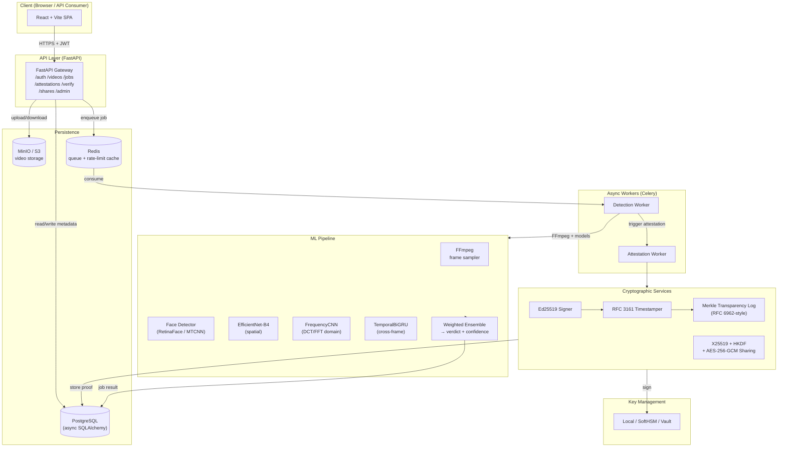
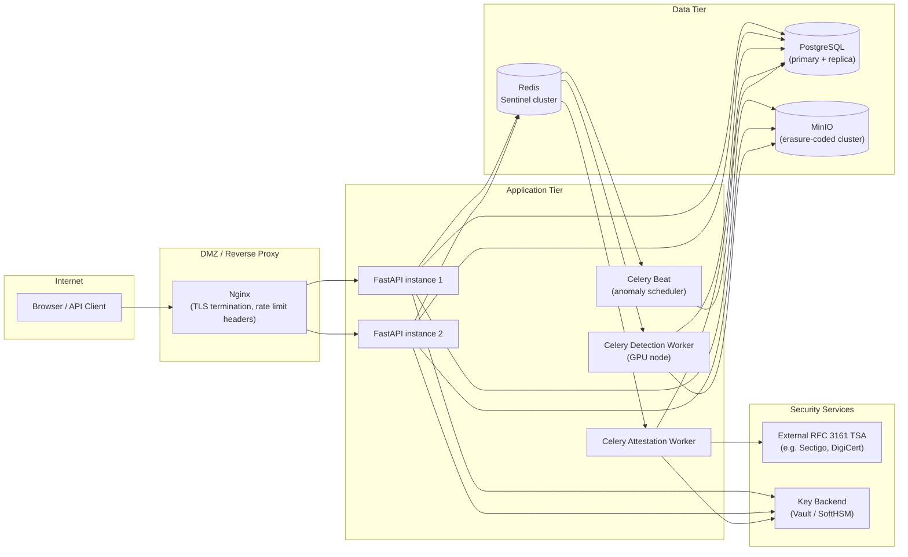

# DeepAuth — System Architecture

> **DeepAuth** is an AI-powered deepfake detection platform with cryptographic provenance verification. It combines multi-modal deep learning with an immutable cryptographic audit trail, allowing third parties to independently verify the authenticity and integrity of a detection result.

---

## Table of Contents

1. [Design Goals](#1-design-goals)
2. [High-Level Component Overview](#2-high-level-component-overview)
3. [Data Flow](#3-data-flow)
4. [Service Descriptions](#4-service-descriptions)
5. [Detection Pipeline](#5-detection-pipeline)
6. [Attestation Service](#6-attestation-service)
7. [Database Schema](#7-database-schema)
8. [Storage Layer](#8-storage-layer)
9. [Key Management](#9-key-management)
10. [Deployment Architecture](#10-deployment-architecture)

---

## 1. Design Goals

| Goal | Description |
|------|-------------|
| **Accuracy** | Ensemble of complementary detectors (spatial, frequency, temporal) to reduce blind spots of any single model. |
| **Verifiability** | Every detection result is signed, timestamped via RFC 3161, and anchored to an append-only Merkle transparency log so the result can be independently verified offline. |
| **Non-repudiation** | Ed25519 signatures bind a specific key to each attestation; revocations are publicly logged. |
| **Confidentiality** | Videos are stored encrypted; shared attestations use X25519 + HKDF + AES-256-GCM so only the intended recipient can decrypt. |
| **Auditability** | Every privileged action (login, upload, revocation, anomaly) is written to an immutable `audit_log` table. |
| **Scalability** | Long-running inference is offloaded to Celery workers backed by Redis; the HTTP tier remains stateless. |

---

## 2. High-Level Component Overview



---

## 3. Data Flow

### 3.1 Upload → Detection → Attestation

```
Client
  │  POST /videos/  (multipart, JWT)
  ▼
FastAPI Gateway
  │  1. Validate JWT, check RBAC
  │  2. Write video record (status=PENDING) → PostgreSQL
  │  3. Stream file → MinIO (S3)
  │  4. Enqueue Celery task (video_id)
  │  5. Return HTTP 202 + job_id
  ▼
Redis (task queue)
  ▼
Detection Worker (Celery)
  │  1. Download video from MinIO
  │  2. FFmpeg: decode → sample N frames (uniform/scene-change)
  │  3. RetinaFace: detect & align face crops per frame
  │  4. EfficientNet-B4 inference (spatial features)
  │  5. FrequencyCNN inference (DCT magnitude spectrum)
  │  6. TemporalBiGRU inference (sequence of frame embeddings)
  │  7. Weighted ensemble → score ∈ [0,1] + verdict label
  │  8. Write job result → PostgreSQL (status=COMPLETE)
  │  9. Trigger Attestation Worker
  ▼
Attestation Worker (Celery)
  │  1. Build signed manifest (SHA-256 of video, model versions,
  │     score, verdict, nonce, ISO-8601 timestamp)
  │  2. Ed25519 sign manifest → signature bytes
  │  3. Submit manifest hash to RFC 3161 TSA → timestamp token
  │  4. Append leaf hash to in-memory Merkle tree → inclusion proof
  │  5. Persist attestation record → PostgreSQL
  │  6. Return attestation_id
  ▼
Client
  │  GET /jobs/{id}         → poll until COMPLETE
  │  GET /attestations/{id} → fetch signed attestation
  │  GET /attestations/{id}/package → full verifiable bundle
```

### 3.2 Verification Flow

```
Verifier
  │  POST /verify/by-id   { attestation_id }
  │    OR
  │  POST /verify/by-upload { file }
  ▼
FastAPI Gateway
  │  1. Fetch attestation record from PostgreSQL
  │  2. Check revocation list
  │  3. Recompute manifest hash, verify Ed25519 signature
  │  4. Verify RFC 3161 timestamp token
  │  5. Verify Merkle inclusion proof
  │  6. Return { valid: bool, details: {...} }
```

---

## 4. Service Descriptions

### 4.1 FastAPI Gateway

- **Framework:** FastAPI with async SQLAlchemy and `asyncpg` driver.
- **Auth middleware:** `python-jose` JWT (HS256, 15-minute access tokens, 7-day refresh tokens). RBAC enforced via route-level `Depends` guards (`role: user | admin`).
- **Rate limiting:** Redis-backed sliding window (per user, per IP). Configurable per route.
- **Validation:** Pydantic v2 schemas for all request/response bodies.
- **CORS:** Strict allowlist; credentials mode enabled only for the configured frontend origin.
- **Health:** `GET /health` returns service status, DB reachability, and worker queue depth.

### 4.2 Celery Workers

- **Broker:** Redis (LIST-based queues).
- **Result backend:** PostgreSQL (via `celery-sqlalchemy-scheduler` or direct job table updates).
- **Queues:** `detection` (GPU-bound, one or more GPU workers) and `attestation` (CPU-bound, lightweight).
- **Retry policy:** Exponential backoff × 3 on transient errors; dead-letter after final failure updates job status to `FAILED`.

### 4.3 Anomaly Detection

- **Algorithm:** Isolation Forest trained on historical usage features (upload rate, geographic spread, request timing).
- **Trigger:** Background Celery beat task samples recent `audit_log` rows and writes flagged events to `anomaly_events`.
- **Admin surface:** `GET /admin/anomalies` returns unresolved anomaly events.

---

## 5. Detection Pipeline

```
Raw video file (any container)
        │
        ▼
  ┌─────────────────────────────────────┐
  │  FFmpeg Decoder                      │
  │  • Decode to raw RGB frames          │
  │  • Uniform temporal sampling         │
  │    (default: 32 frames per video)    │
  │  • Optional: scene-change detection  │
  └───────────────┬─────────────────────┘
                  │  N × (H×W×3) tensors
                  ▼
  ┌─────────────────────────────────────┐
  │  Face Detector (RetinaFace / MTCNN) │
  │  • Bounding box + 5-pt landmarks    │
  │  • Align & crop to 224×224          │
  │  • Skip frames with no face         │
  └──────┬──────────────────────┬───────┘
         │ face crops           │ full frames
         ▼                      ▼
  ┌──────────────┐    ┌────────────────────┐
  │ EfficientNet │    │ FrequencyCNN       │
  │ -B4 (spatial)│    │ Input: DCT mag.    │
  │ Pretrained   │    │ spectrum of face   │
  │ ImageNet     │    │ crop (log-scaled)  │
  │ → p_spatial  │    │ → p_freq           │
  └──────────────┘    └────────────────────┘
         │                      │
         └──────────┬───────────┘
                    │ per-frame scores
                    ▼
         ┌─────────────────────┐
         │ TemporalBiGRU       │
         │ Input: sequence of  │
         │ frame embeddings    │
         │ → p_temporal        │
         └──────────┬──────────┘
                    │
                    ▼
         ┌─────────────────────────────┐
         │ Weighted Ensemble           │
         │                             │
         │ score = w₁·p_spatial        │
         │       + w₂·p_freq           │
         │       + w₃·p_temporal       │
         │                             │
         │ Defaults: w₁=0.4, w₂=0.3,  │
         │           w₃=0.3            │
         │                             │
         │ Verdict:                    │
         │  score < 0.30 →             │
         │    NO_MANIPULATION_DETECTED │
         │  0.30 ≤ score ≤ 0.70 →     │
         │    INCONCLUSIVE             │
         │  score > 0.70 →             │
         │    LIKELY_MANIPULATED       │
         └─────────────────────────────┘
```

**Model Versions** are stored in the job/attestation record so a verifier knows exactly which weights produced the result.

---

## 6. Attestation Service

### 6.1 Manifest Structure

```json
{
  "schema_version": "1.0",
  "attestation_id": "<uuid>",
  "video_sha256": "<hex>",
  "model_versions": {
    "efficientnet_b4": "v2.1.0",
    "frequency_cnn": "v1.3.0",
    "temporal_bigru": "v1.1.0"
  },
  "ensemble_weights": [0.4, 0.3, 0.3],
  "score": 0.87,
  "verdict": "LIKELY_MANIPULATED",
  "analysis_timestamp": "2026-11-09T14:00:00Z",
  "nonce": "<32-byte hex>",
  "signer_key_id": "<key fingerprint>"
}
```

The `nonce` and `analysis_timestamp` together prevent replay attacks: an attacker cannot claim an old attestation applies to a different video without breaking the signature.

### 6.2 Signing & Timestamping

```
manifest (JSON bytes)
       │
       ▼  SHA-256
  manifest_hash (32 bytes)
       │
       ├──► Ed25519 sign (private key from KMS)
       │         → signature (64 bytes)
       │
       └──► RFC 3161 TSA request
                 → TSTInfo { genTime, messageImprint }
                 → timestamp_token (DER bytes)
```

### 6.3 Merkle Transparency Log

- Implements a **binary Merkle tree** (RFC 6962-style).
- Each leaf = `SHA-256(0x00 ‖ manifest_hash)`.
- Internal nodes = `SHA-256(0x01 ‖ left ‖ right)`.
- The **tree head** (root hash + tree size) is persisted periodically and can be published to a public log service.
- `GET /attestations/{id}/package` returns the full verifiable bundle:
  - signed manifest
  - Ed25519 signature
  - RFC 3161 timestamp token
  - Merkle inclusion proof (sibling hashes + leaf index)
  - Signer public key (DER)

### 6.4 Secure Sharing

When a user shares an attestation (`POST /shares/`):

1. Generate ephemeral X25519 keypair.
2. Derive shared secret: `ECDH(ephemeral_priv, recipient_pub)`.
3. `HKDF-SHA-256(shared_secret, salt, info)` → 32-byte AES key.
4. `AES-256-GCM` encrypt attestation package → ciphertext + tag + nonce.
5. Store `{ ephemeral_pub, encrypted_blob }` in `shares` table.

---

## 7. Database Schema

All tables use UUID primary keys and `created_at` / `updated_at` timestamps.

```
┌──────────────────────────────────────────────────────────────────────────────┐
│  users                                                                        │
│  id · email (unique) · hashed_password (Argon2id) · role · is_active         │
│  created_at · updated_at                                                      │
└──────────────────────────────────┬───────────────────────────────────────────┘
                                   │ 1:N
         ┌─────────────────────────▼──────────────────────────┐
         │  videos                                              │
         │  id · owner_id(FK) · filename · minio_key           │
         │  sha256 · size_bytes · status · created_at          │
         └───────────────────┬──────────────────────────────────┘
                             │ 1:1
              ┌──────────────▼───────────────┐
              │  jobs                         │
              │  id · video_id(FK) · status   │
              │  score · verdict              │
              │  model_versions (JSONB)        │
              │  error_message · created_at   │
              │  completed_at                 │
              └──────────────┬────────────────┘
                             │ 1:1
         ┌───────────────────▼──────────────────────────────────┐
         │  attestations                                          │
         │  id · job_id(FK) · manifest (JSONB)                   │
         │  signature (bytea) · timestamp_token (bytea)           │
         │  merkle_leaf_index · merkle_root · tree_size           │
         │  key_id · is_revoked · created_at                      │
         └────────┬─────────────────────────────────────────────-┘
                  │
         ┌────────▼─────────────────┐    ┌──────────────────────┐
         │  revocations              │    │  shares               │
         │  id · attestation_id(FK)  │    │  id · attestation_id  │
         │  reason · revoked_by      │    │  owner_id · recipient  │
         │  revoked_at               │    │  ephemeral_pub (bytea) │
         └───────────────────────────┘    │  encrypted_blob        │
                                          │  expires_at · created_at│
                                          └──────────────────────┘

┌────────────────────────────────┐    ┌─────────────────────────────────────────┐
│  anomaly_events                 │    │  audit_log                               │
│  id · user_id(FK nullable)      │    │  id · actor_id · actor_role              │
│  event_type · severity          │    │  action · target_type · target_id        │
│  features (JSONB) · resolved    │    │  ip_address · user_agent                 │
│  created_at                     │    │  metadata (JSONB) · created_at           │
└─────────────────────────────────┘    └──────────────────────────────────────────┘
```

---

## 8. Storage Layer

### MinIO / S3

| Bucket | Contents | Access |
|--------|----------|--------|
| `deepauth-videos` | Raw uploaded video files, keyed by `video.minio_key` | Private; presigned URLs for worker access |
| `deepauth-exports` | Verifiable attestation bundle archives (optional) | Private |

- Videos are **never stored unencrypted at rest** — MinIO server-side encryption (SSE-S3 or SSE-KMS) is enabled.
- Files are deleted from MinIO when the corresponding `videos` row is deleted (cascaded via Celery cleanup task).

### PostgreSQL

- `asyncpg` driver with connection pooling (min 5, max 20 connections).
- `JSONB` columns for flexible model metadata and audit fields.
- Alembic manages schema migrations.

---

## 9. Key Management

Three backends are supported, selected via `KEY_BACKEND` environment variable:

| Backend | Use Case | Security Level |
|---------|----------|----------------|
| `local` | Development / CI | Low — key on disk, not for production |
| `softhsm` | Staging / university demo | Medium — PKCS#11 software HSM |
| `vault` | Production | High — HashiCorp Vault Transit engine |

Ed25519 private keys **never leave** the key management backend. The signing API accepts a manifest hash and returns a signature.

Key rotation is supported: old key IDs remain in the `attestations` table so historical signatures can still be verified using the archived public key.

---

## 10. Deployment Architecture



**Container layout (Docker Compose / Kubernetes):**

```
deepauth-api          FastAPI (uvicorn, 4 workers)
deepauth-worker-det   Celery detection worker (1 replica per GPU)
deepauth-worker-att   Celery attestation worker (2 replicas)
deepauth-beat         Celery beat scheduler (1 replica)
postgres              PostgreSQL 16
redis                 Redis 7 (or Sentinel)
minio                 MinIO (or external S3)
```
